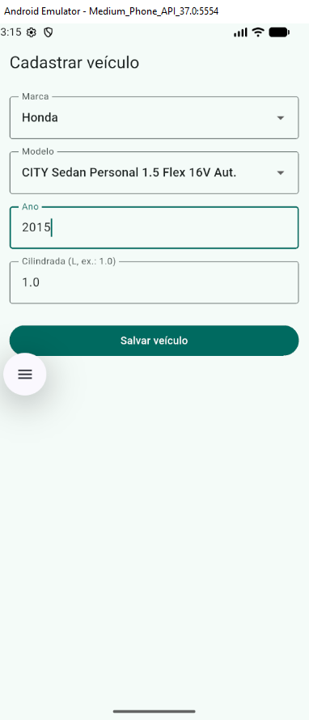
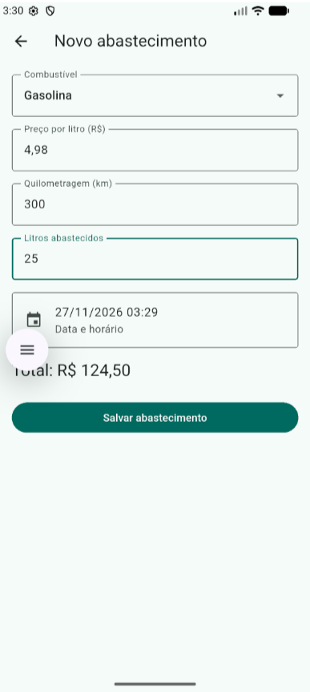
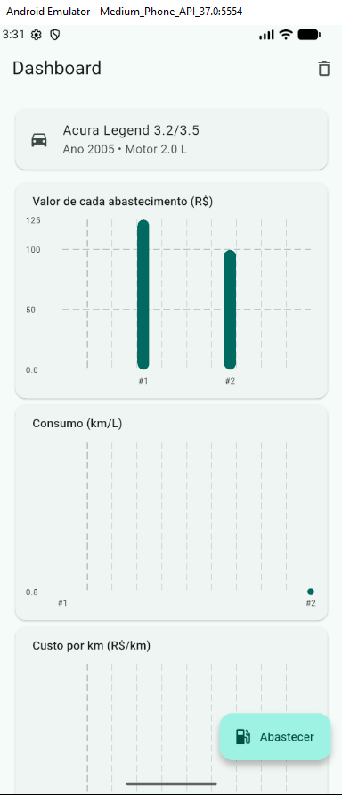
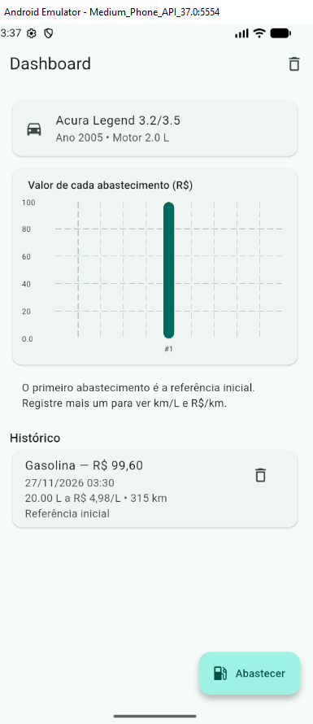
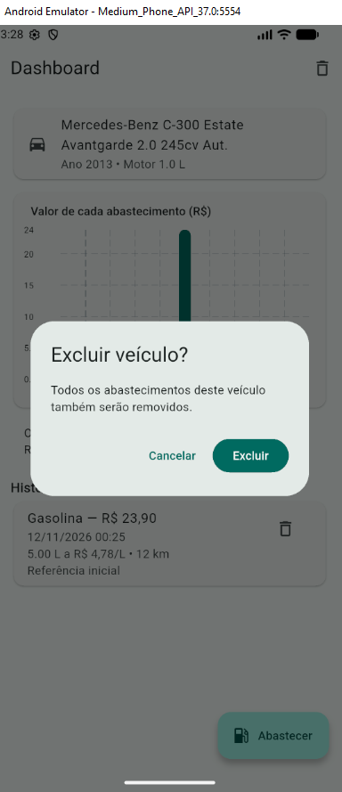

# Controle de Gastos com Combustível

## Descrição
Aplicativo Flutter para registrar abastecimentos de um veículo e acompanhar gastos e consumo (km/L e R$/km) em um dashboard com gráficos.

## Funcionalidades
- Cadastro de um único veículo (marca, modelo, ano, cilindrada); marcas/modelos vêm da API.
- Exclusão do veículo com confirmação (remove também os abastecimentos).
- Registro de abastecimentos (combustível, preço/L, km, litros, data e hora) com total calculado.
- Persistência local: os dados continuam após fechar o app.
- Dashboard: valor de cada abastecimento, km/L e R$/km entre abastecimentos.

## Como executar
```bash
git clone <URL-DO-REPOSITORIO>
cd <pasta>
flutter pub get
flutter run
```
Requer Flutter SDK instalado e internet para consultar a API.

## API utilizada
[BrasilAPI – FIPE](https://brasilapi.com.br/docs#tag/FIPE)
- `GET /api/fipe/marcas/v1/carros`
- `GET /api/fipe/veiculos/v1/carros/{codigoMarca}`

## Bibliotecas
- `http` — consumo da API
- `sqflite` + `path` — banco de dados local (SQLite)
- `fl_chart` — gráficos
- `intl` — formatação de datas e moeda

## Cálculos
- Distância = km atual − km do abastecimento anterior
- km/L = distância ÷ litros do abastecimento atual
- R$/km = valor total do abastecimento atual ÷ distância
- O primeiro abastecimento é a referência inicial (sem indicadores).

## Capturas de tela
### Cadastro do veículo


### Registro de abastecimento


### Dashboard


### Histórico


### Exclusão do veículo

